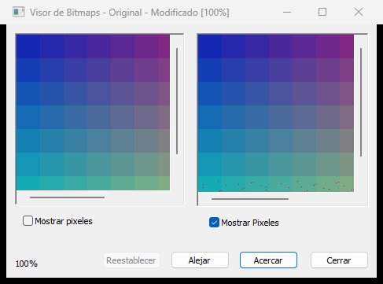
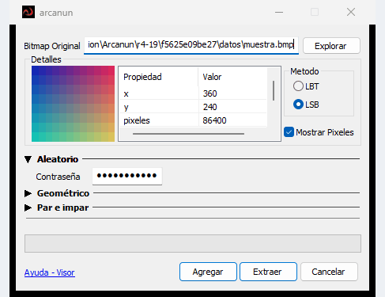

# Arcanun
[English](#english) · [Español](#español)

## English

Legacy Windows application for embedding and recovering a sample file in a BMP image

> [!WARNING]
> **Status: Legacy.** Archived teaching exercise for trusted local samples.

### Overview

Arcanun shows how small changes in a Windows bitmap can carry the contents of a second file. Students can compare the original and modified pixels and then check that the embedded file is recovered with its original name and bytes. The text field called Contraseña selects positions in one historical mode. Use the exercise to observe pixel changes with public or invented content.

### Features

- Displays bitmap dimensions and the estimated capacity for each method.
- Offers random, equation-based and alternate-position modes.
- Saves another BMP and recovers its embedded file using the original image.
- Opens a zoomable side-by-side viewer with a highlight of the selected pixels.
- Compares the width and height returned by Windows with the available pixel bytes. Context help explains the selected control.

### Requirements

Windows desktop, Visual Studio Community 2026 18.11.4, MSVC 14.51.36263 (v145), MFC for x86 and Windows SDK 10.0.26100.0. Build Release for Win32. The exact archived components are included in this revision; see THIRD-PARTY-NOTICES.md.

### Getting started

The archived third-party controls and parser are included. From the repository root in Developer PowerShell for Visual Studio run the commands below.

```powershell
MSBuild arcanun.sln /m:2 /nr:false /t:Rebuild /p:Configuration=Release /p:Platform=Win32 /p:PreferredToolArchitecture=x64
Push-Location bin\Release
.\arcanun.exe
Pop-Location
```

### Usage

Click **Explorar** and select a 24-bit BMP for the verified example. This Windows bitmap stores pixels directly. Choose **LSB**, which uses the least significant bit of a colour value, and **Aleatorio**. Enter a disposable text value used to select positions. Click **Agregar**, choose a plain text file, then save a new BMP. Keep the original BMP. Leave it selected and click **Extraer**. Choose the new BMP and an empty destination folder, using the same method and settings.

Enable **Mostrar Pixeles** before **Agregar** to inspect the images side by side. After recovering `ejemplo.txt`, compare it to the input with `Get-FileHash .\entrada\ejemplo.txt, .\salida\ejemplo.txt`. Use synthetic local files from a source you control.

### Project structure

`archived-media/Logo.bmp` is the bitmap delivered beside the archived executable. The converted project copies it beside the new build. The root bitmap remains as a source asset. The archive also supplies `logo.jpg` and `res/arcanun1.ico`. `nuevo.bmp` is the archive’s additional bitmap.

The November 2005 archive includes [the original manual](ayuda.htm), its 53 supporting files in `ayuda_archivos/` and `arcanuni.nsi`, the historical installer script. The converted build copies the manual and its supporting files beside the executable. It does not run the installer.

`arcanunDlg.cpp` handles the interface. `BmpContenido.cpp` and `BmpHide.cpp` operate on bitmap pixels and payload files. `ViewDlg.cpp` compares the images. The converted solution stays beside `arcanun.vcproj` and `arcanun.legacy.sln`.

SEPARADOR/ contains the controls compiled by arcanun.vcxproj. The entry for the separator control is SEPARADOR/SEPARATOR.CPP. The compat/tmschema.h header bridges the Windows SDK theme constants. The resource script arcanun.rc loads the icon, manifest and res/arcanun.rc2 from res/. docs/media/comparison.png and docs/media/round-trip.gif show the local test. arcanunDlg.cpp opens ayuda.htm for contextual help.

### Support

Include the commit, compiler version, bitmap dimensions and selected method when reporting a problem. Attach synthetic local samples.

### Contributing

Rebuild the solution and compare a recovered text fixture byte for byte before submitting changes. Keep the original dates and author credits with the archived sources.

### History

The earliest recovered edition is dated 5 August 2005. Its date comes from the newest original sources in `arcanun.rar`.

`arcanun11.rar` preserves the 9 November 2005 revision, which validates the selected bitmap, reads the embedded header before allocating the extraction buffer and adds context help. The archive dates are represented at 12:00 UTC.

The first 2026 documentation revision records how to repeat a local round trip and compare the recovered file. The second reconstruction note records the verified round trip and captures.

### Verification

The previously recorded images show the reconstruction trial of November 19, 2026.

**22 November 2026.** Windows 11 Pro build 26300, Visual Studio Community 2026 18.11.4, MSBuild 18.11.1.51303, MSVC 14.51.36263 v145 and Windows SDK 10.0.26100.0. The four independent builds used the listed original components.

- `MSBuild arcanun.sln /m:2 /nr:false /t:Rebuild /p:Configuration=Release /p:Platform=Win32 /p:PreferredToolArchitecture=x64` returned 0 for all four revisions.
- `.\arcanun.exe` ran from `bin\Release`. With LSB and the random-position option, each copy opened a synthetic 360 × 240 BMP, saved a modified copy, opened the viewer and recovered the original 51 bytes with the same SHA-256. Closing with **Cancelar** returned 2, the dialog’s normal cancellation status.

The PNG and GIF show a separate run on November 19 using the same application source. This commit also compiled and ran.





### License

The [MIT license](LICENSE) applies to the project’s own code and documentation. See the [separate notices](THIRD-PARTY-NOTICES.md) for third-party components.

---

## Español

Aplicación legada para Windows que guarda y recupera un archivo de muestra dentro de una imagen BMP

> [!WARNING]
> **Estado: Legado.** Ejercicio archivado para muestras locales de origen conocido.

### Descripción general

Arcanun muestra cómo cambios pequeños en un bitmap de Windows pueden guardar el contenido de un segundo archivo. Permite comparar los píxeles originales con los modificados y verificar que el archivo se recupera con sus bytes y nombre originales. El campo Contraseña elige posiciones en uno de los modos históricos. Usa contenido público o ficticio para observar los cambios.

### Funciones

- Muestra las dimensiones del bitmap y la capacidad estimada de cada método.
- Ofrece selección aleatoria, mediante una ecuación y mediante posiciones alternas.
- Guarda otro BMP y recupera el archivo con ayuda de la imagen original.
- Abre un visor lado a lado con zoom y opción para destacar los píxeles elegidos.
- Compara el ancho y el alto que devuelve Windows con los bytes disponibles para píxeles. La ayuda contextual explica el control seleccionado.

### Requisitos

Windows de escritorio, Visual Studio Community 2026 18.11.4, MSVC 14.51.36263 (v145), MFC para x86 y SDK de Windows 10.0.26100.0. Compila Release para Win32. Los componentes exactos del respaldo se incluyen en esta revisión. Consulta THIRD-PARTY-NOTICES.md.

### Cómo empezar

Los controles y el analizador archivados están incluidos. Desde la raíz, abre Developer PowerShell para Visual Studio y ejecuta los comandos siguientes.

```powershell
MSBuild arcanun.sln /m:2 /nr:false /t:Rebuild /p:Configuration=Release /p:Platform=Win32 /p:PreferredToolArchitecture=x64
Push-Location bin\Release
.\arcanun.exe
Pop-Location
```

### Uso

Pulsa **Explorar** y elige un BMP de 24 bits para el ejemplo verificado. Este formato de Windows guarda los píxeles directamente. Elige **LSB**, que usa el bit menos significativo de un valor de color, y **Aleatorio**. Escribe un texto ficticio que se usará para elegir las posiciones. Pulsa **Agregar**, elige un archivo de texto y guarda un BMP nuevo. Conserva el BMP original. Déjalo seleccionado y pulsa **Extraer**. Selecciona el BMP nuevo y una carpeta vacía con el mismo método y ajustes.

Activa **Mostrar Pixeles** antes de pulsar **Agregar** para ver las imágenes lado a lado. Después de recuperar `ejemplo.txt`, compáralo con el archivo original mediante `Get-FileHash .\entrada\ejemplo.txt, .\salida\ejemplo.txt`. Usa archivos ficticios locales cuyo origen conozcas.

### Estructura del proyecto

`archived-media/Logo.bmp` es el mapa de bits distribuido junto al ejecutable archivado. El proyecto convertido lo copia junto al nuevo binario. Se conserva el mapa de bits de la raíz como recurso fuente. El respaldo también incluye `logo.jpg` y `res/arcanun1.ico`. `nuevo.bmp` es el mapa de bits adicional del respaldo.

El respaldo de noviembre de 2005 incluye [el manual original](ayuda.htm), sus 53 archivos auxiliares en `ayuda_archivos/` y `arcanuni.nsi`, el script histórico del instalador. La compilación convertida copia el manual y sus archivos junto al ejecutable. No ejecuta el instalador.

`arcanunDlg.cpp` controla la interfaz. `BmpContenido.cpp` y `BmpHide.cpp` trabajan con los píxeles y los archivos guardados. `ViewDlg.cpp` compara las imágenes. La solución convertida queda junto a `arcanun.vcproj` y `arcanun.legacy.sln`.

SEPARADOR/ contiene los controles que compila arcanun.vcxproj. El punto de entrada del separador es SEPARADOR/SEPARATOR.CPP. La cabecera compat/tmschema.h enlaza las constantes de temas del SDK de Windows. El script de recursos arcanun.rc carga el icono, el manifiesto y res/arcanun.rc2 desde res/. docs/media/comparison.png y docs/media/round-trip.gif muestran la prueba local. arcanunDlg.cpp abre ayuda.htm para la ayuda contextual.

### Soporte

Incluye el commit, la versión del compilador, las dimensiones del bitmap y el método elegido al reportar un problema. Adjunta muestras locales ficticias.

### Contribuir

Compila la solución y compara un archivo ficticio recuperado byte a byte antes de enviar cambios. Conserva las fechas y los créditos originales con las fuentes archivadas.

### Historial

La primera edición recuperada es del 5 de agosto de 2005. La fecha viene de las fuentes originales más recientes de `arcanun.rar`.

`arcanun11.rar` conserva la revisión del 9 de noviembre de 2005. Valida el bitmap elegido, lee la cabecera del contenido antes de reservar el búfer de extracción y agrega ayuda contextual. Las fechas de respaldo se representan a las 12:00 UTC.

La primera revisión documental de 2026 describe cómo repetir una prueba local y comparar el archivo recuperado. La segunda nota de reconstrucción registra la prueba verificada y sus capturas.

### Verificación

Las imágenes ya registradas muestran la prueba de reconstrucción del 19 de noviembre de 2026.

**22 de noviembre de 2026.** Windows 11 Pro compilación 26300, Visual Studio Community 2026 18.11.4, MSBuild 18.11.1.51303, MSVC 14.51.36263 v145 y SDK de Windows 10.0.26100.0. Las cuatro compilaciones independientes usaron los componentes originales listados.

- `MSBuild arcanun.sln /m:2 /nr:false /t:Rebuild /p:Configuration=Release /p:Platform=Win32 /p:PreferredToolArchitecture=x64` devolvió 0 en las cuatro revisiones.
- `.\arcanun.exe` se ejecutó desde `bin\Release`. Con LSB y el modo aleatorio, cada copia abrió un BMP ficticio de 360 × 240, guardó otro BMP, abrió el visor y recuperó los 51 bytes originales con el mismo SHA-256. Al cerrar con **Cancelar** devolvió 2, el estado normal de cancelación del diálogo.

El PNG y el GIF muestran otra prueba del 19 de noviembre con las mismas fuentes de aplicación. Este commit también compiló y se ejecutó.


### Licencia

La [licencia MIT](LICENSE) aplica al código y la documentación propios. Consulta los [avisos](THIRD-PARTY-NOTICES.md) de los componentes de terceros.
